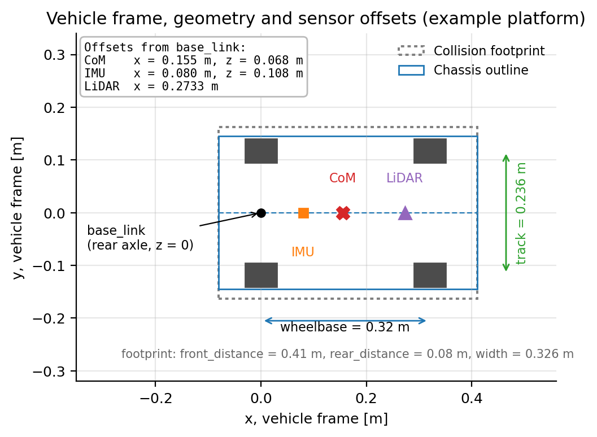
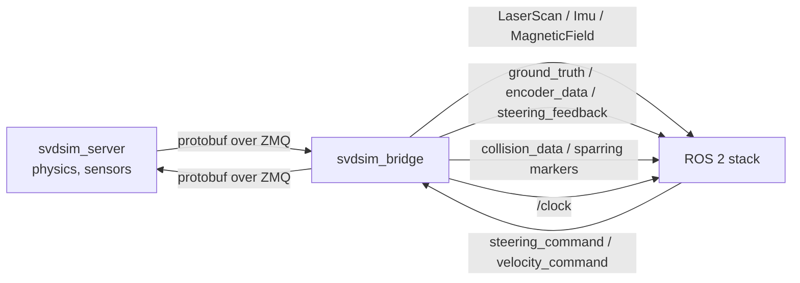

# svdsim_server Parameter Reference

`svdsim_server` is the simulation node of SVDSim. It owns the world model, the vehicle
dynamics, all sensor models and the ZeroMQ endpoints that the `svdsim_bridge` node talks to. It is
implemented as a composable ROS 2 node (`svdsim_server_node`, class
`svdsim_server::SvdsimServerNode`), which runs either standalone or inside a component
container.

## Configuration sections

The configuration file is organised in ten sections that map one-to-one to the pages below.

| Configuration section | Page | What it controls |
|---|---|---|
| Simulation Rate Parameters | [Simulation rates](simulation_rates.md) | Physics rate, sensor rates, real-time factor |
| Map and Grid Configuration | [Map and grid](map_and_grid.md) | Static map, spawned vehicles, ZeroMQ ports |
| LiDAR Parameters | [LiDAR](lidar.md) | Beam geometry, range limits, noise, scan skew |
| Wheel Encoder Parameters | [Wheel encoders](wheel_encoders.md) | Encoder resolution, steering feedback source |
| IMU Sensor Parameters | [IMU](imu.md) | Mounting, noise densities, bias model |
| Tire Model Parameters | [Tires](tires.md) | Pacejka coefficients, combined slip |
| Vehicle Dynamics Parameters | [Vehicle dynamics](vehicle_dynamics.md) | Geometry, mass, limits, drive model, motion model |
| Suspension Simulation Parameters | [Suspension](suspension.md) | Body inclination from load transfer |
| Vehicle Footprint Parameters | [Vehicle footprint](vehicle_footprint.md) | Collision box |
| Sparring Vehicle Parameters | [Sparring](sparring.md) | Autonomous dummy vehicles |

## Parameter file

The node reads a standard ROS 2 parameter file. The complete reference file, with every parameter at
its default, is
[`config_examples/svdsim_server_default.yaml`](../config_examples/svdsim_server_default.yaml).

Every parameter is declared by the node, so a key omitted from the file keeps its declared default.
Values can be overridden on the command line without editing the file:

```bash
ros2 run svdsim_server svdsim_server_node --ros-args \
  --params-file svdsim_server_default.yaml \
  -p physics_rate:=500.0 -p vehicle_dynamics.velocity_max:=8.0
```

`map_path` and `grid_listing_file` are declared read-only and must be set in the file; see
[Map and grid](map_and_grid.md) for their formats.

## Frames and conventions

| Frame | Definition | Used by |
|---|---|---|
| world / `map` | Fixed inertial frame. The map image origin and `initx`/`inity` are expressed here. | Pose, LiDAR raytracing, ground truth |
| `base_link` | Midpoint of the rear axle, `x` forward, `y` left, yaw counter-clockwise. The simulator places it at `z` = 0; in the URDF it sits `rear_axle_height` above `base_footprint`. | Vehicle pose, colliders, all sensor offsets |
| LiDAR frame | `base_link` translated by (`lidar.x_offset`, `lidar.y_offset`) and rotated by `lidar.yaw_offset`. | Range measurements |
| IMU frame | `base_link` translated by (`imu.x_offset`, `imu.y_offset`, `imu.z_offset`) and rotated by roll/pitch/yaw offsets. | Accelerometer, gyroscope, magnetometer |



## Validation rules

Any startup validation failure aborts the node with `std::runtime_error`; the per-section rules are
listed on the section pages.

## Data flow



The bridge republishes the simulation clock; see [Clock and `use_sim_time`](../svdsim_bridge.md#clock-and-use_sim_time).

## Debugging checklist

- **Vehicle does not move** – compare the grid `port` with the bridge `port`, and `velocity_deadband`
  with the commanded speed.
- **Vehicle drifts away from the path** – inspect the steering hysteresis gap and the `use_true_steering_feedback_sensor` flag.

## See also

- [SVD simulator overview](../README.md)
- [Bridge parameters](../svdsim_bridge.md)
- [Message definitions](../svdsim_msgs.md)
- [Protobuf definitions](../svdsim_proto.md)
