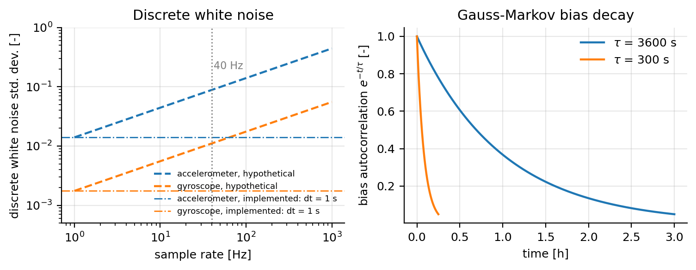

# IMU Sensor Parameters

**Configuration section:** `imu`
**Source:** `svdsim_server/models/imu_sensor_model.cpp`, `svdsim_server/ecs/systems/imu_sensor_system.cpp`

The IMU model produces accelerometer, gyroscope and magnetometer samples in the sensor frame, using
the Barfoot rigid-body kinematics and a Kalibr noise model extended with a first-order Gauss-Markov
bias.

## Parameters

### General

| Parameter | Type | Default | Description |
| --- | --- | --- | --- |
| `imu.sample_rate` | double | 100.0 | Sampling rate [Hz]. The rate must be non-zero; see [Simulation rates](simulation_rates.md). |
| `imu.gravity` | double | 9.81 | Gravity magnitude [m/s^2] used to build the gravity vector. |

### Mounting

| Parameter | Type | Default | Description |
| --- | --- | --- | --- |
| `imu.x_offset` | double | 0.0 | IMU `x` position in the vehicle frame [m]. |
| `imu.y_offset` | double | 0.0 | IMU `y` position in the vehicle frame [m]. |
| `imu.z_offset` | double | 0.05 | IMU `z` position above the `base_link` origin, which is at ground level [m]. |
| `imu.roll_offset` | double | 0.0 | Roll of the IMU case in the vehicle frame [rad]. |
| `imu.pitch_offset` | double | 0.0 | Pitch of the IMU case in the vehicle frame [rad]. |
| `imu.yaw_offset` | double | 0.0 | Yaw of the IMU case in the vehicle frame [rad]. |

### Noise

| Parameter | Type | Default | Description |
| --- | --- | --- | --- |
| `imu.accelerometer_noise_density` | double | 1.40e-02 | White noise density [m/s^2/√Hz]. |
| `imu.accelerometer_random_walk` | double | 4.45e-04 | Bias random-walk density [m/s^3/√Hz]. |
| `imu.gyroscope_noise_density` | double | 1.75e-03 | White noise density [rad/s/√Hz]. |
| `imu.gyroscope_random_walk` | double | 1.05e-05 | Bias random-walk density [rad/s^2/√Hz]. |
| `imu.magnetometer_noise_density` | double | 1.35e-06 | White noise density [T/√Hz]. |
| `imu.accelerometer_tau` | double | 3600.0 | Bias autocorrelation time [s]. |
| `imu.gyroscope_tau` | double | 3600.0 | Bias autocorrelation time [s]. |
| `imu.magnetometer_tau` | double | 300.0 | Bias autocorrelation time [s]. |

### Initial bias

| Parameter | Type | Default | Description |
| --- | --- | --- | --- |
| `imu.initial_accelerometer_bias_x` | double | 0.0 | Initial accelerometer bias [m/s^2]. |
| `imu.initial_accelerometer_bias_y` | double | 0.0 | Initial accelerometer bias [m/s^2]. |
| `imu.initial_accelerometer_bias_z` | double | 0.0 | Initial accelerometer bias [m/s^2]. |
| `imu.initial_gyroscope_bias_x` | double | 0.0 | Initial gyroscope bias [rad/s]. |
| `imu.initial_gyroscope_bias_y` | double | 0.0 | Initial gyroscope bias [rad/s]. |
| `imu.initial_gyroscope_bias_z` | double | 0.0 | Initial gyroscope bias [rad/s]. |
| `imu.initial_magnetometer_bias_x` | double | 0.0 | Initial magnetometer bias [T]. |
| `imu.initial_magnetometer_bias_y` | double | 0.0 | Initial magnetometer bias [T]. |
| `imu.initial_magnetometer_bias_z` | double | 0.0 | Initial magnetometer bias [T]. |

The initial biases are loaded when the sensor is constructed and every time the vehicle state is
reset, which restarts the Gauss-Markov process from the `initial_*_bias_*` parameter.

## Sensor pose

The sensor pose passed to the model is
$T_{base,imu} = \mathrm{Trans}(x, y, z)\,\mathrm{Rot}_z(\psi)\,\mathrm{Rot}_y(\theta)\,\mathrm{Rot}_x(\phi)$.

## Measurement model

### Accelerometer

The accelerometer measures specific force at the sensor origin. With $C_{si}$ the rotation from the
inertial frame to the sensor frame, $C_{iv}$ the rotation from the vehicle frame to the inertial
frame, $\mathbf{r}^{vi}_{i}$ the acceleration of the `base_link` origin in the inertial frame,
$\boldsymbol{\omega}$ and $\dot{\boldsymbol{\omega}}$ the vehicle angular velocity and angular
acceleration in the vehicle frame, $\mathbf{r}_{sv}$ the lever arm from `base_link` to the IMU
expressed in the vehicle frame, and $\mathbf{g}_i = [0, 0, -g]^\top$:

$$
\mathbf{y}_a = C_{si}\left(\mathbf{r}^{vi}_{i} + C_{iv}\left(\dot{\boldsymbol{\omega}} \times \mathbf{r}_{sv} + \boldsymbol{\omega} \times (\boldsymbol{\omega} \times \mathbf{r}_{sv})\right) - \mathbf{g}_i\right) + \mathbf{n}_a + \mathbf{b}_a
$$

The bracketed lever-arm terms are the Euler and centripetal accelerations of a sensor mounted away
from `base_link`.

### Gyroscope

The body and the sensor are assumed to be rigidly attached to the vehicle, so the measured angular
rate is the vehicle angular rate expressed in the sensor frame, with $C_{sv}$ the rotation from the
vehicle frame to the sensor frame and $\boldsymbol{\omega}_{vi}$ the vehicle angular velocity:

$$
\mathbf{y}_g = C_{sv}\,\boldsymbol{\omega}_{vi} + \mathbf{n}_g + \mathbf{b}_g
$$

Only the yaw rate of the planar vehicle model is non-zero; roll and pitch appear as orientation
offsets of the suspension body, not as rates.

### Magnetometer

The world magnetic field is aligned with the inertial `x` axis:

$$
\mathbf{y}_m = C_{si}\,\mathbf{B}_i + \mathbf{n}_m + \mathbf{b}_m, \qquad \mathbf{B}_i = [45\times10^{-6},\,0,\,0]^\top\ \text{T}
$$

## Noise implementation

Let $dt$ be the IMU sampling period used by the noise generator. The discrete white noise is

$$
\sigma_{d} = \frac{\sigma_{nd}}{\sqrt{dt}}
$$

and the bias is propagated as an AR(1) process with innovation $\sigma_{rw,d} = \sigma_{rw}\sqrt{dt}$:

$$
\mathbf{b}_k = e^{-dt/\tau}\,\mathbf{b}_{k-1} + \boldsymbol{\xi}_k, \qquad \boldsymbol{\xi}_k \sim \mathcal{N}(0, \sigma_{rw,d}^2 I)
$$

The total measurement error is $\mathbf{n}_d + \mathbf{b}_k$.

In the simulator $dt$ is not the actual sampling interval: `IMUNoiseParameters::imu_sampling_period`
is never assigned by the node and retains its default of 1.0 s, so the discrete white-noise standard
deviation equals the noise-density parameter at every `imu.sample_rate`, and the bias decay factor
is $e^{-1/\tau}$.

## Notes

- Set the densities from an Allan-variance fit of the real sensor; they act as per-sample standard
  deviations, not spectral densities.
- Non-zero initial biases produce a realistic estimator transient at startup but also shift the mean
  of every channel. Keep them at or below the expected run-to-run repeatability of the sensor.
- Linear and angular acceleration are obtained by backward differences over one **physics** step
  (`dt = 1/physics_rate`), independently of `imu.sample_rate`; the IMU rate only controls how often
  a sample is produced.
- The IMU is sampled after the suspension inclination is applied, so braking and cornering produce
  a gravity component on the horizontal axes; see [Suspension parameters](suspension.md).
- The published covariances are zero, so consumers must supply their own noise; the message fields
  are documented in [Message definitions](../svdsim_msgs.md).

## See also

- [Simulation rates](simulation_rates.md)
