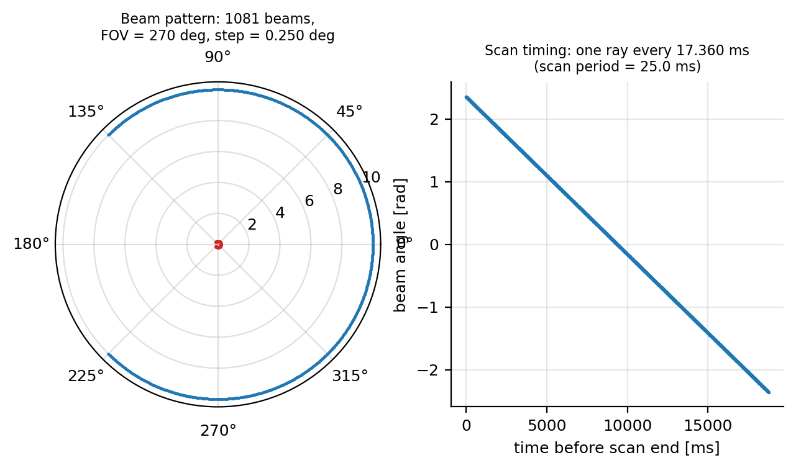

# LiDAR Parameters

**Configuration section:** `lidar`
**Source:** `svdsim_server/models/lidar_sensor_model.cpp`, `svdsim_server/ecs/systems/lidar_sensor_system.cpp`

The LiDAR is simulated by raytracing one ray per beam against the Box2D collision world.

## Parameters

| Parameter | Type | Default | Description |
| --- | --- | --- | --- |
| `lidar.horizontal_fov` | double | 4.712 | Horizontal field of view [rad]. |
| `lidar.horizontal_resolution` | double | 0.00873 | Angular resolution [rad]. |
| `lidar.scan_rate` | double | 20.0 | Scans per second [Hz]. See [Simulation rates](simulation_rates.md) for rate constraints. |
| `lidar.max_distance` | double | 10.0 | Maximum detection range [m]; must be greater than `min_distance`. |
| `lidar.min_distance` | double | 0.1 | Minimum detection range [m]. |
| `lidar.range_noise_stddev` | double | 0.01 | Standard deviation of the additive range noise [m]. |
| `lidar.enable_skew` | bool | `true` | When true, each beam is cast from the vehicle pose at the instant the beam was emitted instead of the pose at the end of the scan. |
| `lidar.x_offset` | double | 0.0 | LiDAR `x` position in the vehicle frame [m]. |
| `lidar.y_offset` | double | 0.0 | LiDAR `y` position in the vehicle frame [m]. |
| `lidar.yaw_offset` | double | 0.0 | LiDAR yaw relative to the vehicle frame [rad]. |

Offsets are expressed in the `base_link` frame.

## Beam geometry

The number of beams is derived from the field of view and the resolution:

$$
N = \left\lfloor \frac{\theta_{fov}}{\Delta\theta} \right\rfloor + 1
$$

The beam angles are distributed over the closed interval $[-\theta_{fov}/2,\, +\theta_{fov}/2]$:

$$
\theta_i = -\frac{\theta_{fov}}{2} + i\,\frac{\theta_{fov}}{N-1}, \qquad i = 0,\dots,N-1
$$

so the effective angular step $\theta_{fov}/(N-1)$ differs marginally from the requested resolution.

## Scan timing and motion compensation

The entire scan is computed in a single activation of the LiDAR system, which is scheduled once per
`1/scan_rate` seconds; no physics step is interleaved with the raytracing. The per-beam offsets
introduced below are look-back times only, used to read past vehicle poses from the trajectory
buffer. The time between two consecutive beams, expressed in simulation clock ticks (one tick equals
one physics step), is

$$
n_{ray} = \frac{f_{physics}}{f_{scan}} \cdot \frac{\theta_{fov}}{2\pi} \cdot \frac{1}{N-1}
$$

When `lidar.enable_skew` is `true`, beam $i$ is cast from the trajectory buffer at
$t - (N-1-i)\,n_{ray}$.

Beam $i$ is cast along $R(\theta_i)$ in the LiDAR frame, transformed to the world by
$T_{world,base}(t)\,T_{base,lidar}$, and the hit distance $r^*$ is obtained from the Box2D raytrace.

## Range noise and validity

$$
r_i = \begin{cases}
r_i^* + \eta, & \eta \sim \mathcal{N}(0, \sigma_r^2) \\[4pt]
\text{NaN}, & r_i^* + \eta < r_{min} \ \text{or}\ r_i^* + \eta > r_{max}
\end{cases}
$$

$\sigma_r$ is `lidar.range_noise_stddev`, drawn independently per beam.

## Published message

`svdsim_bridge` republishes each scan as a `sensor_msgs/msg/LaserScan` in the
`lidar_frame_id` frame with:

| Field | Value |
|---|---|
| `angle_min`, `angle_max` | `-horizontal_fov/2`, `+horizontal_fov/2` |
| `angle_increment` | `horizontal_fov / (N - 1)` |
| `time_increment` | `1 / (scan_rate * N)` |
| `scan_time` | `1 / scan_rate` |
| `range_min`, `range_max` | `lidar.min_distance`, `lidar.max_distance` |
| `ranges` | $N$ entries, `NaN` for invalid beams |

Consumers that integrate range rates over a single scan should use `scan_time`.
See [Bridge parameters](../svdsim_bridge.md) for the topic name and frame.

## Notes

- Scan cost scales with the number of beams (one raytrace per beam); reducing `horizontal_resolution`
  is the dominant cost lever.
- `max_distance` also drives cost: the raytrace query is issued with `max_distance + 1` metres.
- `enable_skew` only matters at high yaw rates; see
  [Scan timing and motion compensation](#scan-timing-and-motion-compensation).

## See also

- [Simulation rates](simulation_rates.md)
- [Vehicle footprint parameters](vehicle_footprint.md)
