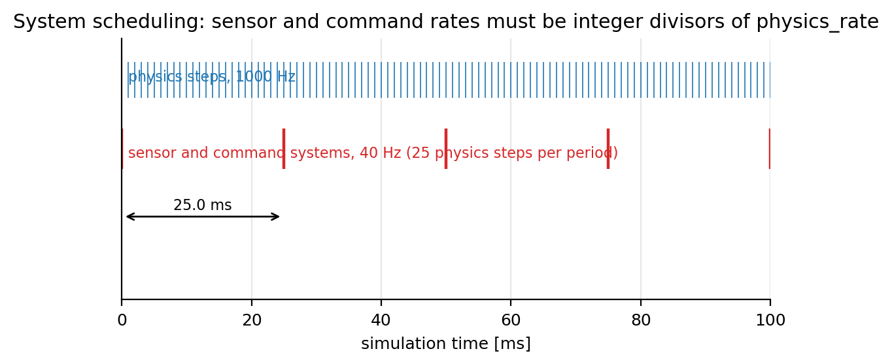

# Simulation Rate Parameters

**Configuration section:** `svdsim_server.ros__parameters` (top level)
**Source:** `svdsim_server/src/svdsim_server_node.cpp`

The simulation server runs a single simulation thread. Physics is advanced in fixed steps at
`physics_rate`, while sensors, command processing and ground truth streaming are executed as
periodic systems that are scheduled on the same clock.

## Parameters

| Parameter | Type | Default | Description |
| --- | --- | --- | --- |
| `physics_rate` | double | 1000.0 | Physics integrator frequency [Hz]. Sets the RK4 step (`dt = 1/physics_rate`) and the resolution of the simulation clock. Declared range [1, 10000]. |
| `command_rate` | double | 20.0 | Rate [Hz] at which remote-control commands are read from the ZeroMQ servers. Also used for sparring control and collision counting. Declared range [1, 1000]. |
| `odometry_rate` | double | 20.0 | Rate [Hz] at which wheel-encoder odometry (and steering feedback) is published. Declared range [0, 1000]. |
| `ground_truth_rate` | double | 100.0 | Rate [Hz] at which the ground truth vehicle state is streamed. Declared range [0, 1000]. |
| `rtf_report_interval` | double | 3.0 | Interval [s] between real-time-factor log messages. Declared range [0.1, 60]. |

## Scheduling rule

For every scheduled rate $f$ (command, odometry, ground truth, IMU and LiDAR) the scheduler
computes

$$
n = \frac{f_{\text{physics}}}{f}, \qquad n \in \mathbb{N}
$$

and activates the corresponding system every $n$ physics steps. `physics_rate` drives the loop
directly and `rtf_report_interval` is only a logging period, so neither is scheduled. The
fractional part of $n$ must be zero; otherwise `load_parameters()` throws:

```text
Parameter 'command_rate' must be an integer divider of 'physics_rate'. 1000.000000 / 30.000000 = 33.333333 (not an integer)
```

Scheduling for a 1000 Hz physics loop and 40 Hz systems:



## Rate to system mapping

| Rate parameter | Scheduled system | Period |
|---|---|---|
| `physics_rate` | `PhysicsSimulationSystem` (not queued; driven by the loop) | 1 step |
| `ground_truth_rate` | `GroundtruthSensorSystem` | `physics_rate / ground_truth_rate` |
| `command_rate` | `RemoteControlSystem`, `SparringControlSystem`, `CollisionCountSystem` | `physics_rate / command_rate` |
| `lidar.scan_rate` | `LidarSensorSystem` | `physics_rate / lidar.scan_rate` |
| `imu.sample_rate` | `ImuSensorSystem` | `physics_rate / imu.sample_rate` |
| `odometry_rate` | `OdometrySensorSystem` | `physics_rate / odometry_rate` |

## Real-time factor control

The simulation thread does not run as fast as possible. The elapsed simulation time
$\Delta t_{sim}$ is compared with the elapsed wall-clock time $\Delta t_{wall}$: when the
simulation is ahead of the wall clock ($\Delta t_{sim} > \Delta t_{wall}$) the thread sleeps for
the difference, which keeps the real-time factor close to 1.0. Every
`rtf_report_interval` seconds the baseline is re-anchored and the average RTF of the window is
logged:

```text
Average real-time factor over the last 3.0 seconds: 1.0
```

If a system is activated later than its scheduled timestamp, the node logs
`System activated late: ... This indicates that the system is not keeping up with real-time.`
A persistent late activation or an RTF well below 1.0 means that the host cannot sustain the
requested `physics_rate`; reduce it (for example to 500 Hz) before reducing sensor rates.

## Zero rates

A rate of 0 is not a supported configuration: the sensor component is not created, but its system
is still queued with period `physics_rate / 0`, which is undefined.

## Tuning guidance

- `physics_rate` is the main cost driver. The drive model, the RK4 integration and collider
  updates all run per physics step. Rates below 200 Hz degrade the fidelity of bang-bang steering
  and the speed of raytracing.
- Keep `lidar.scan_rate` and `imu.sample_rate` at or below the 40 Hz at which the stack consumes
  them; a faster sensor only adds unused samples.
- Keep `command_rate` at least as high as the controller rate of the autonomy stack (40 Hz on the
  reference platform) to avoid command aliasing.

## See also

- [Map and grid configuration](map_and_grid.md)
- [LiDAR parameters](lidar.md), [IMU parameters](imu.md), [wheel encoders](wheel_encoders.md)
