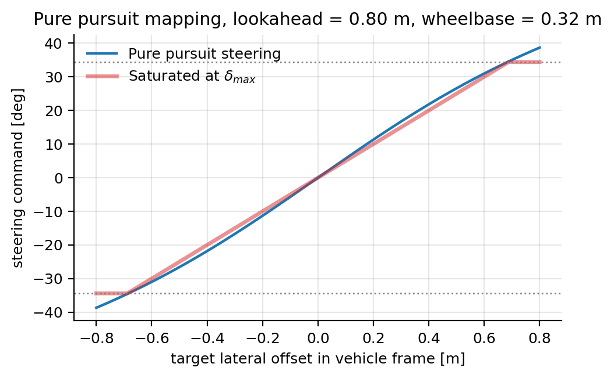

# Sparring Vehicle Parameters

**Configuration section:** `sparring`
**Source:** `svdsim_server/utils/pure_pursuit_controller.cpp`, `svdsim_server/ecs/systems/sparring_control_system.cpp`, `svdsim_server/utils/trajectory_reader.cpp`

Sparring vehicles are autonomous dummy cars that follow a fixed trajectory at a constant speed. They
are spawned by adding rows with `type = sparring` to the vehicle grid file and are intended for
overtaking and multi-vehicle experiments. All sparring vehicles share the same trajectory, speed and
controller parameters.

## Parameters

| Parameter | Type | Default | Description |
| --- | --- | --- | --- |
| `sparring.trajectory_file` | string | `""` | Absolute path to a trajectory CSV file. Mandatory if the grid contains at least one sparring vehicle. |
| `sparring.constant_velocity` | double | 2.5 | Constant speed along the trajectory [m/s]. Declared range [0, 10]. |
| `sparring.lookahead_distance` | double | 0.8 | Pure-pursuit lookahead distance [m]. Declared range [0.1, 5]. |
| `sparring.max_steering` | double | 0.6 | Absolute steering limit applied to the pure-pursuit command [rad]; independent of `vehicle_dynamics.steering_max` and applied only to the sparring controller output. Declared range [0.1, 1.57]. |

Sparring vehicles need a trajectory in addition to the map:

```yaml
svdsim_server:
  ros__parameters:
    map_path: "/path/to/maps/2025-icra-compete/map.yaml"
    sparring:
      trajectory_file: "/path/to/maps/2025-icra-compete/centerline_trajectory.csv"
```

## Trajectory file format

A CSV file with a header row containing at least the columns `x` and `y`:

```csv
x,y
0.00,0.00
1.00,0.05
2.00,0.21
```

- Both columns are mandatory. Columns beyond those named in the header are ignored, but a data row
  with fewer fields than the header row aborts startup.
- The trajectory must contain at least three points.
- It is treated as **closed**: the lookahead search wraps around with `index % N`, so the last point
  is implicitly connected to the first. For a closed race track no repeated first point is needed.

The trajectories produced by the offline raceline tools (`centerline_trajectory.csv`,
`shortest_path_trajectory.csv`, `minimum_curvature_trajectory.csv`) can be used directly.

## Pure-pursuit controller

The controller runs at `command_rate`. In each cycle it:

1. finds the trajectory point closest to the vehicle;
2. walks forward along the trajectory until the accumulated arc length reaches
   `lookahead_distance`, interpolating the exact target point;
3. transforms the target into the vehicle frame and computes the curvature

    $$
    \kappa = \frac{2\,y_L}{L^2}
    $$

    with $y_L$ the lateral offset of the target and $L$ its Euclidean distance (approximately the
    lookahead distance);
4. converts the curvature into a steering angle with the single-track relation

    $$
    \delta = \arctan(L_{wb}\,\kappa)
    $$

    and clamps it to $\pm$`max_steering`.



The steering clamp is reached only for large lateral offsets. A shorter lookahead tracks the path
more tightly but produces larger, more oscillatory steering commands; a longer lookahead cuts
corners.

## Velocity and actuation

- The velocity reference is the constant `sparring.constant_velocity`; there is no speed profile, so
  the cars do not slow down for corners.
- Sparring vehicles always use the `single_track_kinematic` model, even when
  `vehicle_dynamics.dynamic_model` is `single_track_drift`.
- They use the same drive model as the ego vehicle, with the exception that
  `velocity_deadband` is forced to 0 so that the commanded constant speed is never gated to zero.
- Sensors attached to sparring vehicles: ground truth only. They do not publish LiDAR, IMU or
  encoder data.

## Behaviour in the grid

| Grid setting | Effect |
|---|---|
| No `sparring` rows | `sparring.trajectory_file` may stay empty; nothing is loaded. |
| One or more `sparring` rows | The trajectory is loaded once per sparring vehicle; the server throws if the file is empty or missing. |
| `initx`, `inity`, `inityaw` | Spawn pose. The controller immediately starts pursuing the trajectory, so a spawn pose far from the path produces a transient where the vehicle cuts towards the path. |

## See also

- [Sparring markers](../svdsim_bridge.md#sparring-markers)
- [Map and grid configuration](map_and_grid.md)
- [Vehicle dynamics parameters](vehicle_dynamics.md)
- [Bridge parameters](../svdsim_bridge.md)
- [Sparring vehicles guide](../../sparring_vehicles.md)
