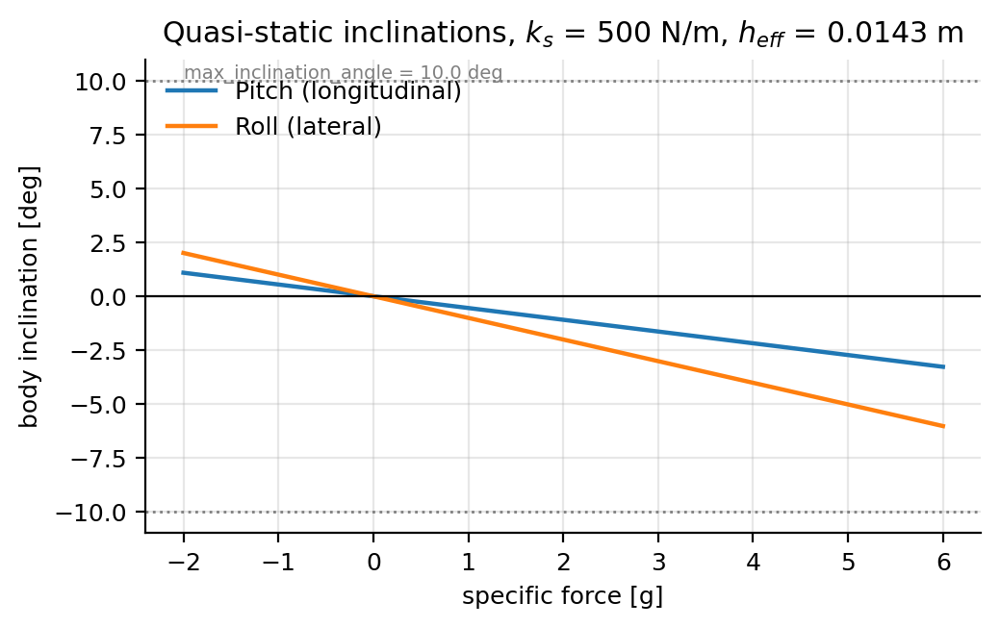

# Suspension Parameters

**Configuration section:** `suspension`
**Source:** `svdsim_server/models/sprung_mass_inclination_model.cpp`

The suspension model does not simulate spring dynamics. It computes the quasi-static body inclination
that balances the inertial force acting on the sprung mass against the restoring moment of the four
springs. The resulting orientation is used only by the IMU: the vehicle pose provided to the rest of
the stack stays planar.

## Parameters

| Parameter | Type | Default | Description |
| --- | --- | --- | --- |
| `suspension.spring_stiffness` | double | 500.0 | Spring stiffness at each corner [N/m]. Declared range [1, 10000]. |
| `suspension.roll_center_height` | double | 0.0325 | Height of the roll centre above the ground [m]. Declared range [-0.5, 0.5]. |
| `suspension.max_inclination_angle` | double | 0.174533 | Maximum absolute pitch or roll angle [rad] (10 deg). Declared range [0, 0.785398]. |

> **Configuration caveat.** `roll_center_height` is independent of `vehicle_dynamics.effective_wheel_radius`;
> set it explicitly rather than assuming the two coincide.

## Model

The inclination is derived from the horizontal component of the inertial force acting on the sprung
mass at the centre of mass. The accelerometer is sampled inside this model with the identity body
rotation ($C_{vb} = I$), so gravity appears only on the vertical axis and the horizontal force used
is $m\,a_{xy}$, with $m$ the sprung mass. For a horizontal force $\mathbf{F}_{xy}$ applied at the
centre of mass:

$$
\theta = -\frac{h_{eff}\,\lVert \mathbf{F}_{xy} \rVert}{k_s \sum_i \left(\mathbf{r}_i \cdot \hat{\mathbf{u}}_F\right)^2},
\qquad h_{eff} = z_{com} - z_{rc}
$$

where:

- $\mathbf{r}_i$ are the four lever arms from the centre of mass to the wheels, projected on the
  horizontal plane,
- $\hat{\mathbf{u}}_F = \mathbf{F}_{xy} / \lVert \mathbf{F}_{xy} \rVert$ is the direction of the
  inertial force,
- $k_s$ is `spring_stiffness` (per corner),
- $z_{com}$ is `vehicle_dynamics.center_of_mass_z` and $z_{rc}$ is `roll_center_height`.

The angle is clamped to $\pm$`max_inclination_angle`.

The inclination stays small at realistic specific forces; the clamp is only reached with
unrealistically soft springs or a very high centre of mass.

## Consequences for the IMU

The body rotation $C_{vb}$ is applied before the IMU transformation. As a result:

- the accelerometer sees a horizontal gravity component of $g\sin\theta$, which is the signal a
  real IMU would produce during load transfer;
- the gyroscope axes are rotated with the body, so the measured yaw rate is scaled by $\cos\theta$;
- the magnetometer axes tilt, which changes the measured horizontal field direction.

Because the inclination is quasi-static, there is no pitch or roll rate in the state.

## Tuning guidance

- `spring_stiffness` scales the inclination inversely. Calibrate it from a static measurement: apply
  a known longitudinal acceleration, measure the pitch angle of the real car, and solve the equation
  above for $k_s$.
- `roll_center_height` changes only $h_{eff}$. Setting it equal to $z_{com}$ removes the inclination
  entirely, which is a convenient way to isolate other effects during testing.
- `max_inclination_angle` prevents the linearised model from producing non-physical angles during
  collisions or numerical transients. 10 deg is a safe upper bound for a RoboRacer-scale vehicle.

## See also

- [IMU sensor parameters](imu.md)
- [Vehicle dynamics parameters](vehicle_dynamics.md)
