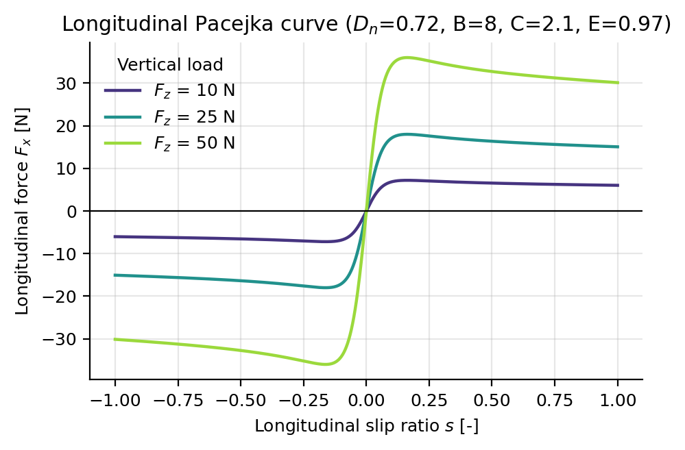
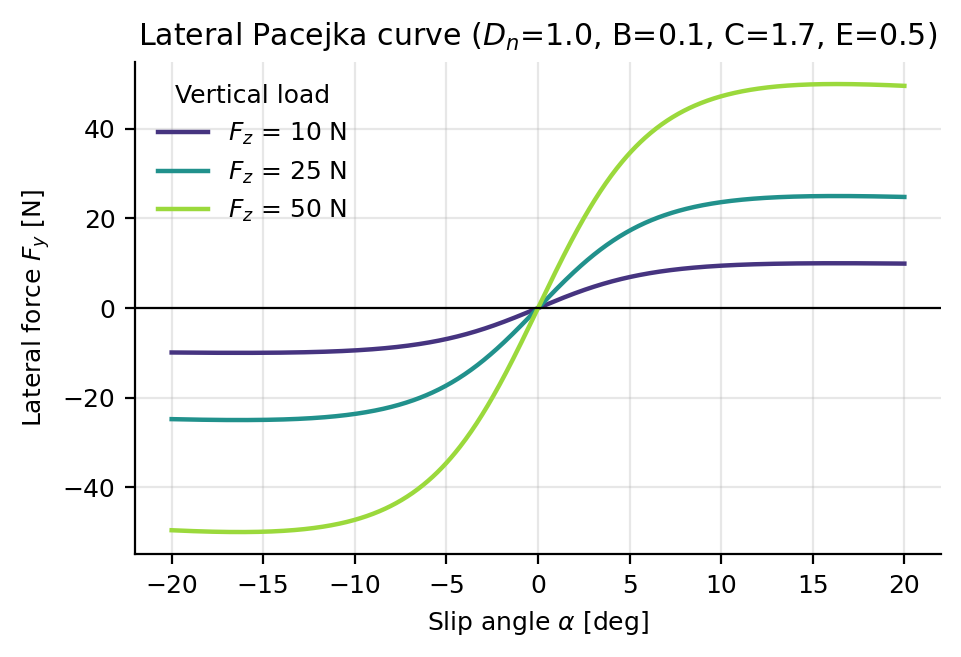
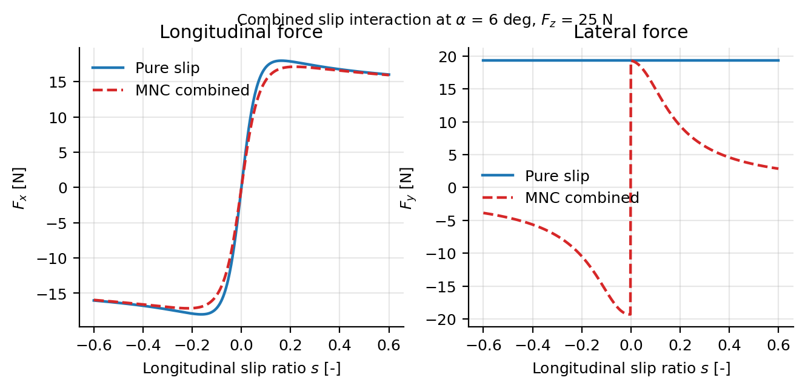

# Tire Model Parameters

**Configuration section:** `tires`
**Source:** `svdsim_server/models/mnc_tire_model.cpp`

The tire model converts slip into longitudinal and lateral forces. Pure-slip forces are produced by
the Pacejka Magic Formula; when combined slip is enabled, the Modified Nicolas-Comstock (MNC) model
couples the two directions. The tires section is only used when
`vehicle_dynamics.dynamic_model` is `single_track_drift`; the kinematic model performs no force
computation.

## Parameters

| Parameter | Type | Default | Description |
| --- | --- | --- | --- |
| `tires.model` | string | `modified_nicolas_comstock` | Tire model selector. Only this value is accepted; any other value aborts startup. |
| `tires.combined_slip` | bool | `true` | Enables the MNC combined-slip coupling. When false, longitudinal and lateral forces are computed independently from the same slip inputs. |
| `tires.longitudinal.Dn` | double | 1.0 | Normalised peak factor [-]. |
| `tires.longitudinal.B` | double | 8.0 | Stiffness factor [1/slip ratio]. |
| `tires.longitudinal.C` | double | 2.1 | Shape factor [-]. |
| `tires.longitudinal.E` | double | 0.97 | Curvature factor [-]. |
| `tires.lateral.Dn` | double | 1.0 | Normalised peak factor [-]. |
| `tires.lateral.B` | double | 0.1 | Stiffness factor [1/deg]. |
| `tires.lateral.C` | double | 1.7 | Shape factor [-]. |
| `tires.lateral.E` | double | -1.6 | Curvature factor [-]. |

The lateral `B` is per degree because the slip angle is passed to the lateral curve in degrees; the
cornering stiffness used by the combined-slip coupling is converted to per radian.

## Pacejka Magic Formula

For a slip input $x$ (slip ratio $s$ for the longitudinal direction, slip angle $\alpha$ in degrees
for the lateral direction) and a vertical load $F_z$:

$$
F = D \sin\!\Big(C \arctan\big(Bx - E\,(Bx - \arctan(Bx))\big)\Big), \qquad D = D_n F_z
$$

The stiffness used by the combined-slip coupling is the slope at the origin, $B\,C\,D_n F_z$.

## Slip definition

The model receives the contact-patch velocities $v_x$, $v_y$, the wheel angular rate $\omega$ and the
vertical load $F_z$. With $r_w$ the effective wheel radius, it first computes

$$
v_w = r_w \omega, \qquad
s = \frac{|v_w - v_x|}{\max(|v_x|, |v_w|)}, \qquad
\alpha = \operatorname{atan2}(|v_y|, |v_x|)
$$

Both $s$ and $\alpha$ are magnitudes; the sign is restored at the end:
$F_x \leftarrow \operatorname{sgn}(v_w - v_x)\,F_x$ and
$F_y \leftarrow -\operatorname{sgn}(v_y)\,F_y$. When the normalisation denominator
$\max(|v_x|, |v_w|)$ is below $10^{-6}$ the model returns $F_x = 0$ and
$F_y = -\operatorname{sgn}(v_y)\,F_z D_{n,lat}$, i.e. the static-friction limit.

## Modified Nicolas-Comstock combined slip

When combined slip is enabled, the MNC model couples both force directions through a shared
denominator built from the pure-slip forces. With $F_{0x}(s)$ the pure longitudinal force,
$F_{0y}(\alpha)$ the pure lateral force and $C_s$, $C_\alpha$ the corresponding stiffnesses:

$$
\begin{aligned}
Q &= \sqrt{(s F_{0y})^2 + (F_{0x}\tan\alpha)^2} \\
F_x &= \frac{F_{0x} F_{0y} \sqrt{(s C_\alpha)^2 + (F_{0x}\cos\alpha)^2}}{Q\,C_\alpha} \\
F_y &= \frac{F_{0x} F_{0y} \sqrt{\big((1-s) F_{0y}\cos\alpha\big)^2 + (C_s \sin\alpha)^2}}{Q\,C_s \cos\alpha}
\end{aligned}
$$

## Tuning guidance

- Calibrate `Dn` from the friction coefficient: the peak longitudinal force of a tire is
  approximately `mu * Fz`, so `Dn` should be close to `mu`.
- The model prints a warning to `stderr` whenever a negative force is computed before the sign is
  applied, which indicates inconsistent Pacejka parameters.
- Tune `B` and `E` together against measured tire data. Raising `B` sharpens the peak and can make
  the drift model numerically stiff at low speed; `E > 1` steepens the post-peak fall, and negative
  values flatten it.
- Enable `combined_slip` when the vehicle is expected to brake and steer simultaneously (trail
  braking, drifting).

## References

- Brach, R. M., and Brach, R. M. (2000). *Modeling Combined Braking and Steering Tire Forces.* SAE
  Technical Paper 2000-01-0357.
- Guiggiani, M. (2018). *The Science of Vehicle Dynamics.* Springer.

## See also

- [Vehicle dynamics parameters](vehicle_dynamics.md)
- [Suspension parameters](suspension.md)
