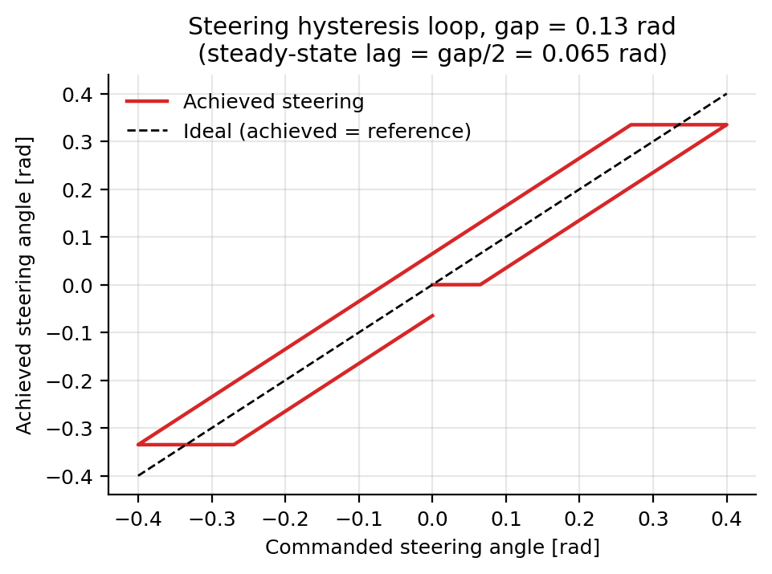
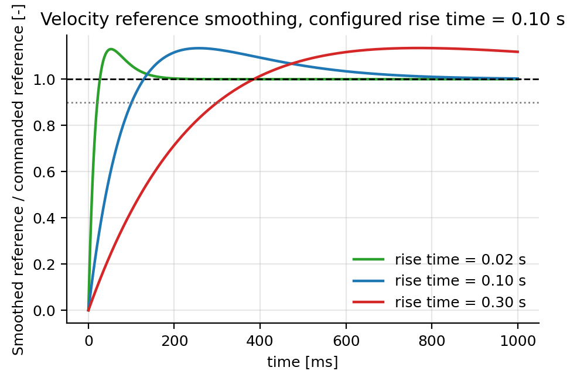

# Vehicle Dynamics Parameters

**Configuration section:** `vehicle_dynamics`
**Source:** `svdsim_server/models/single_track_kinematic_model.cpp`, `svdsim_server/models/single_track_drift_model.cpp`, `svdsim_server/models/simple_drive_model.cpp`

This section covers the geometry, inertia, limits, drive model and motion-model selection.

## Parameters

### Model selection and geometry

| Parameter | Type | Default | Description |
| --- | --- | --- | --- |
| `vehicle_dynamics.dynamic_model` | string | `single_track_kinematic` | `single_track_kinematic` or `single_track_drift`. Any other value aborts startup. |
| `vehicle_dynamics.wheelbase` | double | 0.3 | Distance between front and rear axles [m]. Declared range [0.1, 5]. |
| `vehicle_dynamics.rear_track_width` | double | 0.2 | Rear track width [m]. Declared range [0.05, 2]. |
| `vehicle_dynamics.front_track_width` | double | 0.2 | Front track width [m]. Declared range [0.05, 2]. |
| `vehicle_dynamics.effective_wheel_radius` | double | 0.05 | Effective rolling radius [m]. Declared range [0.01, 0.5]. |
| `vehicle_dynamics.center_of_mass_x` | double | 0.15 | Distance from the rear axle to the centre of mass [m]. |
| `vehicle_dynamics.center_of_mass_z` | double | 0.04684 | Height of the centre of mass above the ground [m]. Declared range [0, 1]. |

### Mass and inertia

| Parameter | Type | Default | Description |
| --- | --- | --- | --- |
| `vehicle_dynamics.sprung_mass` | double | 3.47 | Mass supported by the suspension [kg]. Declared range [0.1, 1000]. |
| `vehicle_dynamics.unsprung_mass` | double | 0.109 | **Unsprung mass per tire** [kg]. Declared range [0.01, 100]. |
| `vehicle_dynamics.yaw_inertia` | double | 0.04712 | Yaw moment of inertia [kg m^2]. Declared range [0.001, 10]. |
| `vehicle_dynamics.wheel_inertia` | double | 0.00028 | Rotational inertia of a single wheel [kg m^2]. Declared range [1e-5, 1]. |
| `vehicle_dynamics.engine_torque_split` | double | 0.5 | Fraction of drive torque sent to the front axle [-]; the rear axle receives `1 - value`. Declared range [0, 1]. |
| `vehicle_dynamics.brake_torque_split` | double | 0.5 | Fraction of braking torque sent to the front axle [-]. Declared range [0, 1]. |

The total vehicle mass is computed at startup as

$$
m = m_{sprung} + 4\,m_{unsprung}
$$

> **Configuration caveat.** `unsprung_mass` is a per-tire quantity: set it to the mass of one wheel
> and tire, not to the mass of all four.

### Steering

| Parameter | Type | Default | Description |
| --- | --- | --- | --- |
| `vehicle_dynamics.steering_max` | double | 0.6 | Positive steering limit [rad]. Declared range [0, 1.57]. |
| `vehicle_dynamics.steering_min` | double | -0.6 | Negative steering limit [rad]. Declared range [-1.57, 0]. |
| `vehicle_dynamics.steering_velocity_max` | double | 3.2 | Maximum steering rate [rad/s]. Declared range [0, 10]. |
| `vehicle_dynamics.steering_hysteresis_gap` | double | 0.0 | Full width of the steering hysteresis loop [rad]. Declared range [0, 1.57]. |

`steering_min` is never read.

### Speed and acceleration limits

| Parameter | Type | Default | Description |
| --- | --- | --- | --- |
| `vehicle_dynamics.acceleration_max` | double | 7.0 | Maximum drive acceleration [m/s^2]. Declared range [0, 20]. |
| `vehicle_dynamics.braking_deceleration` | double | 9.0 | Braking deceleration magnitude [m/s^2] (positive). |
| `vehicle_dynamics.velocity_max` | double | 5.0 | Maximum velocity [m/s]. Declared range [0, 50]. |
| `vehicle_dynamics.velocity_min` | double | -2.0 | Minimum (reverse) velocity [m/s]. Declared range [-10, 0]. |
| `vehicle_dynamics.velocity_deadband` | double | 0.0 | Reference magnitudes below this value are treated as zero [m/s]. |
| `vehicle_dynamics.motor_drive_rise_time` | double | 0.1 | 90 % rise time of the second-order velocity-reference filter [s]. Declared range [0.001, 1]. |
| `vehicle_dynamics.velocity_switch` | double | 3.5 | Reserved for a speed-dependent model switch. Declared range [0, 20]. |

`velocity_max` must be strictly greater than `velocity_min`; the node throws otherwise.

## Drive model: references to actuator commands

The autonomy stack sends a steering angle and a velocity. The drive model converts them into the
steering rate and acceleration that the single-track model integrates, emulating the bang-bang
behaviour of the VESC-based actuator chain.

### Steering rate and hysteresis

Let $\delta_{ref}$ be the commanded angle, $\delta$ the current angle, $h$ the hysteresis gap and
$\Delta t = 1/f_{physics}$:

$$
\tilde{\delta} = \operatorname{clamp}(\delta_{ref}, -\delta_{max}, \delta_{max})
$$

$$
\hat{\delta} = \begin{cases}
\max(\tilde{\delta} - h/2,\ \delta), & \tilde{\delta} > \delta \\[4pt]
\min(\tilde{\delta} + h/2,\ \delta), & \tilde{\delta} \le \delta
\end{cases}
$$

$$
\dot{\delta} = \operatorname{clamp}\!\left(\frac{\hat{\delta} - \delta}{\Delta t},\ \pm\dot{\delta}_{max}\right),
\qquad \text{then clamped so that } |\delta + \dot{\delta}\Delta t| \le \delta_{max}
$$

The hysteresis makes the achieved angle settle $h/2$ behind the reference in each direction, which
reproduces the dead band of a real servo.

### Velocity

$$
\tilde{v} = \operatorname{clamp}\big(\text{filter}(v_{ref}),\ v_{min},\ v_{max}\big), \qquad
v_{eff} = \begin{cases} 0, & |\tilde{v}| < v_{deadband} \\ \tilde{v}, & \text{otherwise}\end{cases}
$$

The acceleration is chosen to reach the effective reference within one step, bounded by
`acceleration_max` when speeding up and by `braking_deceleration` when slowing, with separate forward
and reverse branches.

The filter is a second-order reference shaper with critically damped poles ($\zeta = 1$) and a lead
zero, and natural frequency

$$
\omega_n = \frac{0.781616}{t_{r,90}}
$$

where $t_{r,90}$ is `motor_drive_rise_time`. The response reaches 90 % of a step at $t_{r,90}$ with
about 13.5 % overshoot.

## Motion models

### `single_track_kinematic`

Seven-state planar bicycle model with state
$(x, y, \delta, v, \psi, \varphi_L, \varphi_R)$ and input $(\dot{\delta}, a)$:

$$
\dot{x} = v\cos\psi, \qquad
\dot{y} = v\sin\psi, \qquad
\dot{\psi} = \frac{v}{L}\tan\delta, \qquad
\dot{\delta} = u_0, \qquad
\dot{v} = u_1
$$

with $L$ the wheelbase. The model is integrated with fourth-order Runge-Kutta at `physics_rate`.
See [sparring vehicle parameters](sparring.md) for the model applied to sparring vehicles.

### `single_track_drift`

Twelve-state model with yaw rate, vehicle slip angle, front and rear wheel speeds and longitudinal
acceleration as additional states, and tire forces from [the tire model](tires.md). At or below
0.15 m/s the model uses its kinematic formulation and above it the dynamic formulation.

The drift model requires the tire parameters to be calibrated; with default coefficients it can
oscillate near the 0.15 m/s cut-over.

## Tuning guidance

- `steering_hysteresis_gap` is the parameter that most strongly affects path tracking in simulation.
  Set it to the value measured on the target vehicle; 0.13 rad is representative of the real car.
- `velocity_deadband` should carry the value measured on the target vehicle (0.75 m/s is typical
  for the RoboRacer drivetrain). Lower values make low-speed manoeuvres, such as three-point turns,
  possible in simulation.
- `acceleration_max` and `braking_deceleration` of 20 m/s^2 are far above what the tires can
  deliver. They only bound the command; the kinematic model has no force limit, so a high value
  effectively makes the speed loop instantaneous. Reduce them if the simulated vehicle should
  respect a friction-limited acceleration profile.
- `motor_drive_rise_time` is the main knob for matching the speed-loop bandwidth of the real car.
  Measure a velocity step on the hardware, extract its 90 % rise time, and use that value here; 0.1 s
  is a reasonable starting point for the VESC-based platform.

## See also

- [Tire model parameters](tires.md)
- [Suspension parameters](suspension.md)
- [Wheel encoder parameters](wheel_encoders.md)
- [Vehicle footprint parameters](vehicle_footprint.md)
