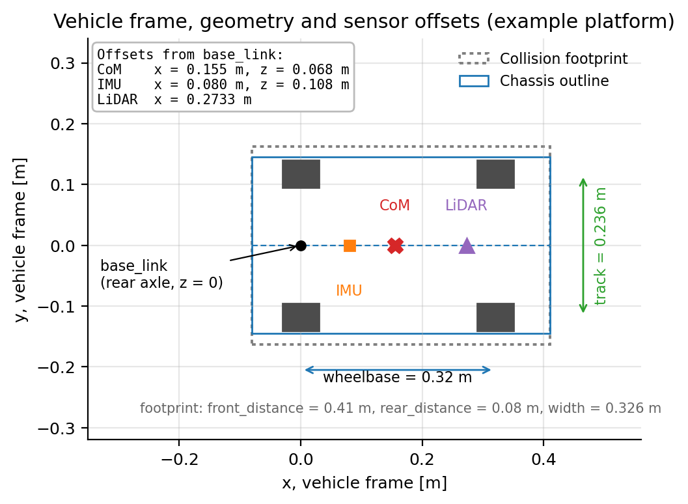

# Vehicle Footprint Parameters

**Configuration section:** `vehicle_footprint`
**Source:** `svdsim_server/src/svdsim_server_node.cpp` (`create_user_controlled_vehicle`, `create_sparring_vehicle`)

The footprint defines the rectangle that represents the vehicle in the Box2D world. It is used for
vehicle-to-vehicle collisions and for wall collisions. It is not used for the dynamics and it is
independent of the visual (URDF) geometry.

## Parameters

| Parameter | Type | Default | Description |
| --- | --- | --- | --- |
| `vehicle_footprint.width` | double | 0.3 | Full width of the collision box [m]. Declared range [0.05, 3]. |
| `vehicle_footprint.front_distance` | double | 0.3 | Distance from `base_link` to the front edge of the box [m]. Declared range [0.01, 5]. |
| `vehicle_footprint.rear_distance` | double | 0.3 | Distance from `base_link` to the rear edge of the box [m]. Declared range [0.01, 5]. |

## Geometry

The collider is a rectangle defined by two opposite corners in the vehicle frame, with
`d_front` = `front_distance`, `d_rear` = `rear_distance` and `w` = `width`:

$$
(\text{front},\ \text{left}) = (+d_{front},\ +w/2), \qquad
(\text{rear},\ \text{right}) = (-d_{rear},\ -w/2)
$$

The rectangle is anchored at `base_link`, which sits at the rear axle, so the two distances are not
symmetric about the chassis. A box that encloses the car follows the overhangs:

$$
d_{front} = L_{wb} + o_{front}, \qquad d_{rear} = o_{rear}, \qquad w \ge w_{track} + 2\,w_{tyre}
$$

The figure uses $d_{front}$ = 0.41 m, $d_{rear}$ = 0.08 m and $w$ = 0.326 m for a 0.32 m wheelbase.
The declared defaults (0.3 m for all three) are placeholders: with equal front and rear distances the
box is centred on the rear axle, extends 0.3 m behind the car and cuts through the front wheels, so
the three values must be set for the platform in use.

## Interaction with the LiDAR

The ego collider is not excluded from the raytrace; self-returns are handled by the
[LiDAR range rule](lidar.md#range-noise-and-validity). Reducing `lidar.min_distance` or enlarging the
footprint narrows the margin.

## Interaction with collision counting

`CollisionCountSystem` evaluates the Box2D overlap at `command_rate`; the published counters and
their meaning are described in [Message definitions](../svdsim_msgs.md).

## Tuning guidance

- Increase `front_distance` and `rear_distance` when the vehicle should keep a safety margin from
  walls, for example while validating a planner that assumes an inflated footprint.
- Decrease them when the simulator must reproduce tight gaps, for example during overtaking
  experiments with sparring vehicles.
- `width` should be at least the track width plus two tire widths; raise it for lateral margin, for
  example to cover mirrors on a different platform.

## See also

- [LiDAR parameters](lidar.md)
- [Map and grid configuration](map_and_grid.md)
- [Sparring vehicle parameters](sparring.md)
